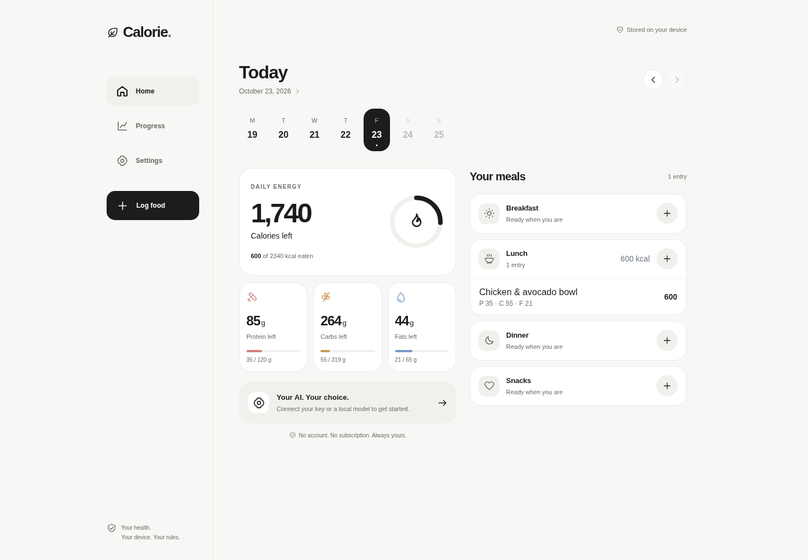
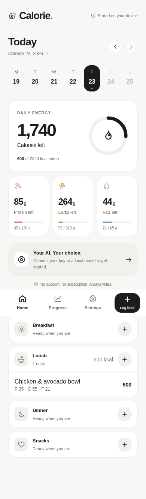
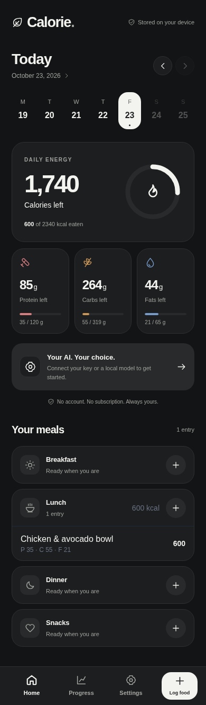

# Interface refresh

A Cal AI-inspired visual direction for the existing local-first tracker: charcoal actions, warm white surfaces, large nutrition totals, muted macro colors, consistent line icons, and a weekly calendar. The screenshots use synthetic meals entered through the app.

The phone layout uses bottom navigation and a prominent logging action. Larger screens use a sidebar and a two-column daily overview. Onboarding, logging, photo capture, settings, charts, and install icons share the updated style. System, light, and dark themes remain available, along with keyboard focus indicators and reduced-motion support.

Logs, goals, and API keys stay in the browser's existing IndexedDB database. AI requests go to the configured provider (Google Gemini or OpenAI) with the user's own key. Barcode lookup continues to use Open Food Facts. No account, new backend, analytics, or remote font dependency is introduced.

## Desktop

## Phone

| Light                                        | Dark                                      |
| -------------------------------------------- | ----------------------------------------- |
|  |  |

## Verification

- Lint, TypeScript, 59 unit/integration tests, and production PWA build pass.
- Chromium checks at 360px, 390px, and 1440px cover navigation, onboarding, manual food entry, editing, calorie totals, reload persistence, selected date/meal propagation, local vision model configuration, photo logging entry point, themes, and weight logging.
- No horizontal overflow at 360px across home, logging, settings, progress, manual entry, photo, text, and barcode screens.
- Automated axe WCAG A/AA checks report no violations for onboarding, home, logging, settings, progress, and manual entry in light mode, and home, logging, and settings in dark mode.
- Camera hardware, live provider inference, and native iOS/Android behavior require testing on devices; no real AI key was used for these checks.
